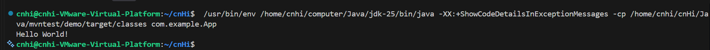
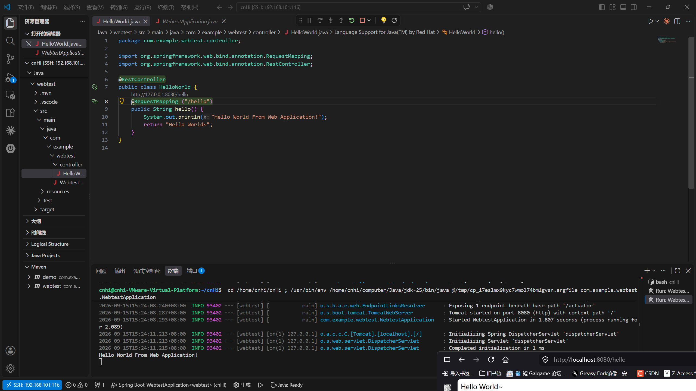

# 环境配置笔记

## 开发环境

本次招新使用 Java + VScode 在 Linux 上完成。
仅需下载较新版本的 jdk 、maven 等即可，再在 vscode 中下载好 Extension Pack for Java 和 Spring Boot Extension Pack 即可，其中前者包含 maven 的相应拓展。

## 相关配置流程

## 1. jdk 下载

在 java 官网下载需要的版本即可。这里选用 `jdk-25` 。  
将下载的文件解压到选定文件夹，例如 `/home/user_name/computer/Java` ，为方便索引，将解压出的文件夹改名为 `jdk-25` 。

## 2. maven 下载

同上，在官网下载后解压到选定文件夹，这里位置为 `/home/user_name/computer/maven/apache-maven-3.9.16` 。

## 3. 环境变量配置

环境变量这里选择在系统全局变量写好 `JAVA_HOME` 和 `MAVEN_HOME` 后再在 `\home\user_name\.bashrc` 写 `exprot`。

不先在系统变量写好的话在 vscode 上的 maven 拓展会出问题，大概原因就是这个拓展会在 vscode 自带的终端运行且直接调用 mvn ，不调用 `.bashrc` ，导致拓展找不到 `JAVA_HOME`（可恶的 vscode 让我在这上面折腾了 1 小时**）。

在终端输入 `sudo nano etc/environment` 写入 `JAVA_HOME=/home/user_name/computer/Java/jdk-25` 和 `MAVEN_HOME=/home/user_name/computer/maven/apache-maven-3.9.16` 。

然后在 `.bashrc` 中追加如下指令:

```shell
export PATH="$JAVA_HOME/bin:$MAVEN_HOME/bin:$PATH"
```

在终端输入 `javac -v` 和 `mvn -v` ，若正常出现版本号则配置成功。

## 4. maven 的相关配置

在 maven 目录的 conf 文件夹找到 `settings.xml` ，在对应位置加入：

```xml
<localRepository>/home/user_name/computer/maven/apache-maven-3.9.16/repo</localRepository>
......
<mirrors>
    <mirror>
      <id>alimaven</id>
      <mirrorOf>central</mirrorOf>
      <name>aliyun maven</name>
      <url>https://maven.aliyun.com/nexus/content/groups/public/</url>
    </mirror>
</mirrors>
```

\<localRepository>需要在相应位置添加相应的库。

## 5. VScode 拓展下载及相应配置

在 vscode 的拓展中找到 `extension pack for Java` 和 `Spring Boot Extension Pack` 两个拓展，下载即可。

然后在 vscode 的远程配置文件 `settings.json` 中添加：

```json
{
    "java.jdt.ls.java.home": "/home/user_name/computer/Java/jdk-25",
    "java.configuration.runtimes": [
        {
        "name": "JavaSE-25",
        "path": "/home/user_name/computer/Java/jdk-25",
        "default": true
        }
    ],
    "maven.executable.path": "/home/user_name/computer/maven/apache-maven-3.9.16/bin/mvn",
}
```

现在就可以顺利创建 maven 项目并运行了！


## SpringBoot Web 运行结果

远程 Linux 创造的端口 VScode 可以点击下方的端口进行转发，从而在本机浏览器打开。
本质是自动执行了:

```bash
ssh -L 8080:localhost:8080 user_name@Ubuntu的IP
```


