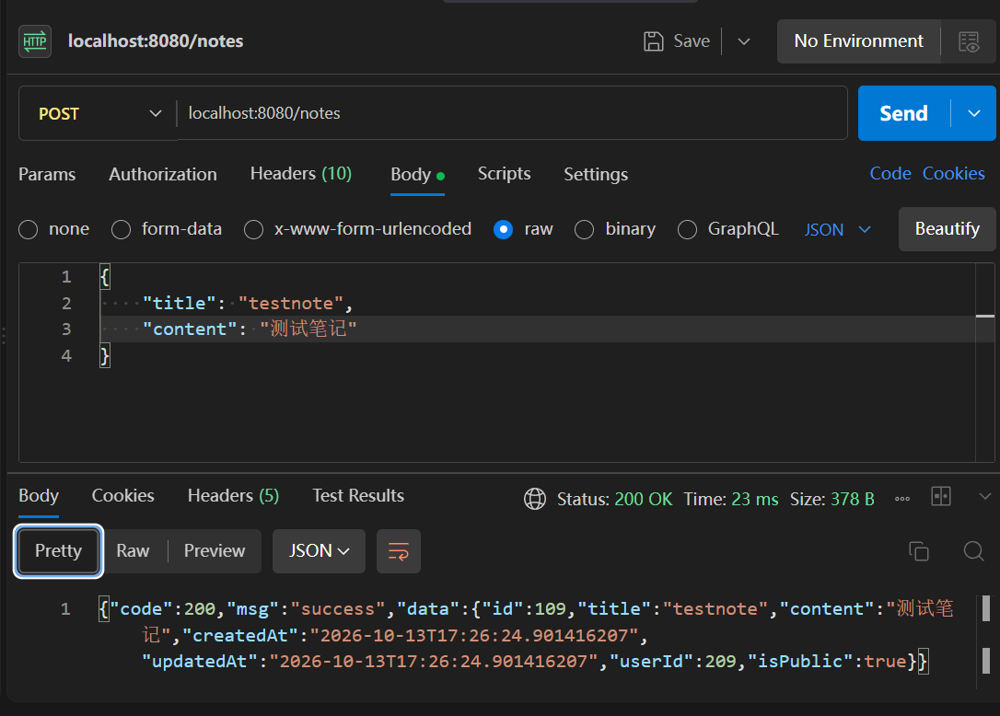
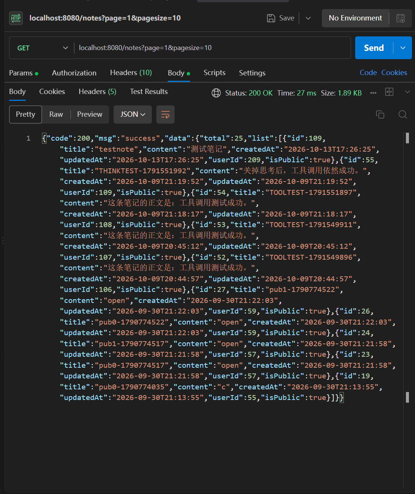
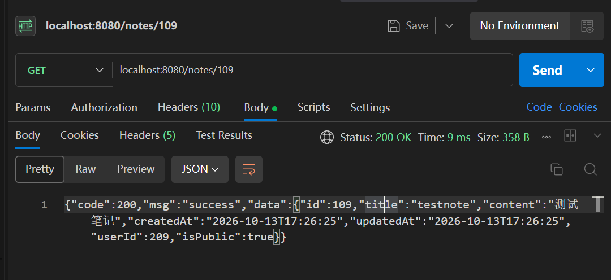
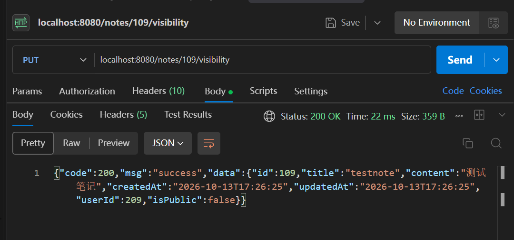
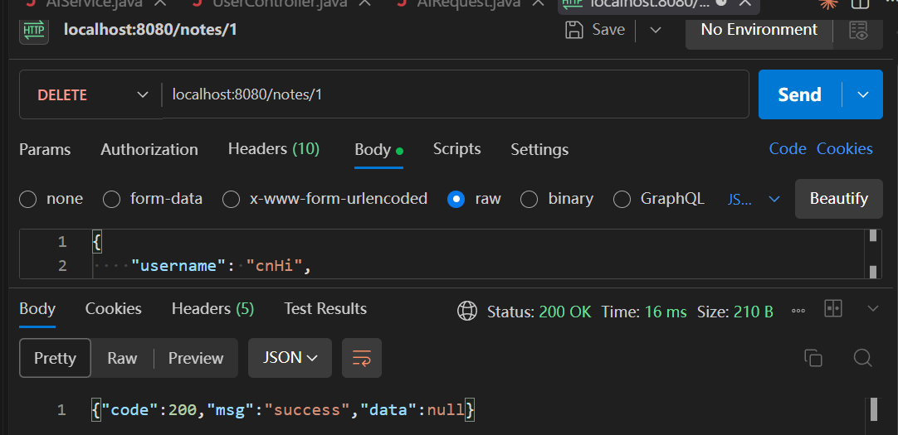
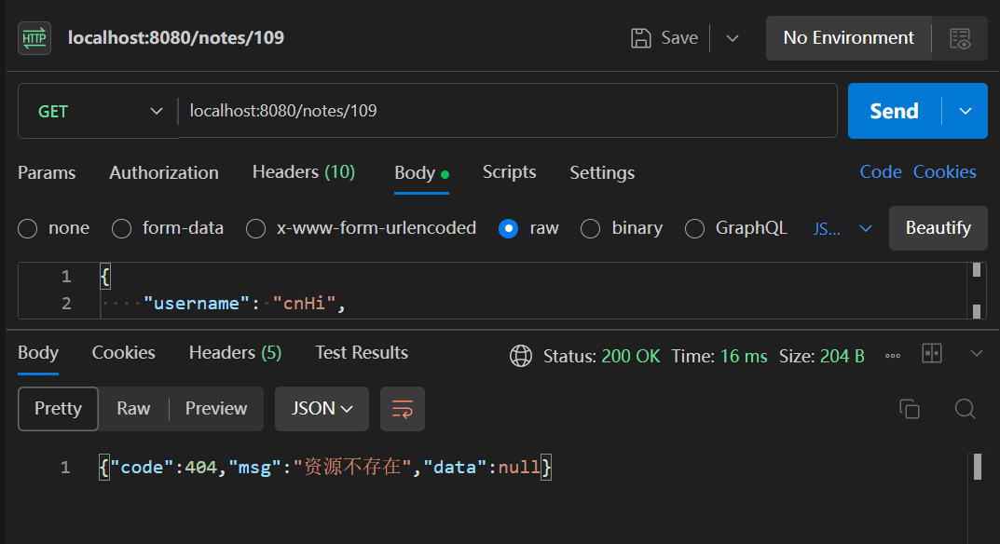

# 笔记模块

笔记模块是项目的核心，负责笔记的增删改查、分页与关键字搜索，以及公开/私密两种可见性。

读写两条路的权限判断不一样。读的时候，别人的私密笔记会当成"不存在"处理；写的时候，动别人的笔记会明确告诉"没权限"。这个区别是有意做的，下面会说明原因。

涉及的代码：

- `controller/NoteController.java`
- `service/NoteService.java`
- `mapper/NoteMapper.java` 和 `resources/com/example/mapper/NoteMapper.xml`
- `entity/Note.java`
- `common/PageBean.java`

## 一、使用流程

### 1. 新建笔记

发 `POST /notes`，请求体只要 `title` 和 `content`。

`userId`、`createdAt`、`updatedAt` 都是服务端补的，客户端传了也会被覆盖。



> 图示：Postman 调 `POST /notes`，展示请求体和返回的带 id 的 Note。

### 2. 列表与分页

发 `GET /notes?page=1&pagesize=10`。

`page` 默认 1，`pagesize` 默认 10。返回的是 `PageBean`，里面 `total` 是总条数，`list` 是当前页的数据。



> 图示：Postman 调 `GET /notes?page=1&pagesize=10`，展示返回的 PageBean。

列表只包含公开笔记，私密的不会出现。

### 3. 关键字搜索

加一个 `keyword` 参数就行，`GET /notes?keyword=xxx`。

匹配范围是标题和正文，任意一个包含就算命中。

### 4. 查看详情

发 `GET /notes/{id}`。



> 图示：Postman 调 `GET /notes/{id}`。

### 5. 编辑

发 `PUT /notes/{id}`，请求体带 `title` 和 `content`。

`createdAt` 不变，`updatedAt` 会刷新成当前时间。

### 6. 切换公开/私密

发 `PUT /notes/{id}/visibility`，不需要请求体。

这个接口是"取反"，不传目标状态。调一次公开变私密，再调一次变回公开。



> 图示：连着调两次 `PUT /notes/{id}/visibility`，展示 `isPublic` 从 true 变 false 再变回 true。

### 7. 我的笔记和别人的笔记

- 看自己的：`GET /users/mynotes`，包含自己的私密笔记
- 看别人的：`GET /users/{userId}/notes`，只有对方的公开笔记

### 8. 删除

发 `DELETE /notes/{id}`。



> 图示：Postman 调 `DELETE /notes/{id}`，展示返回的 Result。

### 9. 权限

三种越权情况，返回的码不一样：

- 读别人的私密笔记，返回 404
- 改别人的笔记，返回 403
- 删别人的笔记，返回 403



> 图示：用另一个账号访问这篇私密笔记，展示返回的 404。

## 二、核心逻辑

### 1. 两个不同的权限检查

读和写走的是两个方法，语义不一样。

写操作用 `checkOwner`：

```java
// 归属校验
private Note checkOwner(Long id, Long userId) {
    Note existing = noteMapper.getById(id);
    if (existing == null) {
        throw new BusinessException(404, "资源不存在");
    }
    if (!existing.getUserId().equals(userId)) {
        throw new BusinessException(403, "无权操作他人的笔记");
    }
    return existing;
}
```

编辑、删除、切换可见性都先调它。笔记不存在是 404，笔记存在但不是你的就是 403。

读操作在 `getById` 里自己判：

```java
// GET：查看指定笔记
@Cacheable(cacheNames = "note", key = "#id", unless = "!#result.isPublic")
public Note getById(Long id, Long userId) {
    Note existing = noteMapper.getById(id);
    if (existing == null) {
        throw new BusinessException(404, "资源不存在");
    }
    if (!existing.getIsPublic() && !existing.getUserId().equals(userId)) {
        throw new BusinessException(404, "资源不存在");
    }
    return existing;
}
```

**关键在第二个判断抛的是 404 而不是 403。**

如果返回 403，等于告诉调用方"这篇笔记是存在的，只是你看不了"。别人就能拿 id 一个个试，靠 403 和 404 的差别把私密笔记的 id 全试出来，虽然看不到内容，但能知道有多少篇、都是哪些编号。

返回 404 就把"不存在"和"不给你看"混成一件事，试 id 得不到额外信息。

写操作不存在这个问题，因为能写到别人的笔记，说明本来就知道它存在，所以直接返回 403 更清楚。

### 2. 服务端补的字段

`create` 里这几个字段是服务端定的，客户端传什么都不作数：

```java
// POST：新建笔记
@CacheEvict(cacheNames = "noteList", allEntries = true)
@Transactional(rollbackFor = Exception.class)
public Note create(Note note, Long userId) {
    LocalDateTime now = LocalDateTime.now();
    note.setCreatedAt(now);
    note.setUpdatedAt(now);
    note.setUserId(userId);
    note.setIsPublic(true); // is_public 暂不支持设置，固定为公开

    if (noteMapper.insert(note) <= 0) {
        throw new BusinessException(500, "服务器错误");
    }
    ...
}
```

`userId` 取自拦截器放进请求上下文的那个值，**不是客户端传的**。如果让客户端自己传 `userId`，谁都能冒充别人发笔记。

`isPublic` 目前固定给 true，新建的笔记一律公开，要变私密得建完再调切换接口。这行有注释标着是暂时的。

### 3. 参数合理化

分页参数进来先夹一遍：

```java
// 参数合理化
page = (page < 1 ? 1 : page);
pagesize = (pagesize > 100 ? 100 : pagesize);
pagesize = (pagesize < 1 ? 10 : pagesize);
```

`pagesize` 封顶 100 是为了防止有人传个 `pagesize=1000000`，一次把整张表拉出来。

### 4. 动态 SQL

条件不确定的部分交给 MyBatis 的标签，不在 Java 里拼字符串。

`NoteMapper.xml` 里抽了一段公共条件：

```xml
<sql id="keywordFilter">
    <where>
        is_public = 1
        <if test="keyword != null and keyword != ''">
            AND (title LIKE CONCAT('%', #{keyword}, '%')
            OR content LIKE CONCAT('%', #{keyword}, '%'))
        </if>
    </where>
</sql>
```

- `<where>` 自动补 `WHERE`，并且会去掉开头多出来的 `AND`，所以 `<if>` 里可以放心以 `AND` 开头
- `<if>` 只在关键字非空时才拼模糊查询，这样"查全部"和"搜索"共用一个语句
- `<include>` 把这整段复用给查询和计数两处，两边条件天然一致

更新用的是 `<set>`：

```xml
<update id="update">
    UPDATE note_table 
    <set>
        <if test="title != null">title=#{title},</if>
        <if test="content != null">content=#{content},</if>
        updated_at=#{updatedAt},
    </set>
    WHERE id = #{id}
</update>
```

`<set>` 会自动补 `SET` 并去掉结尾多余的逗号。传了哪个字段就更新哪个，没传的不动。

### 5. 分页要查两次

```java
int offset = (page - 1) * pagesize;
List<Note> list = noteMapper.queryByKeyword(keyword, offset, pagesize);
Long total = noteMapper.countByKeyword(keyword);
return new PageBean<Note>(total, list);
```

一条取当前页的数据，一条算总条数。前端要靠 `total` 才知道有多少页。

**两条的 `WHERE` 必须一致**，这就是把条件抽成 `<include>` 的原因。如果计数那条漏了 `is_public = 1`，总条数会把私密笔记也算进去，页数就和实际对不上。

分页用的是 `LIMIT #{offset}, #{pagesize}`，offset 表示跳过多少条。

### 6. 可见性过滤写在 SQL 里

查某个用户的笔记时，可见性直接写在 `WHERE` 里：

```xml
<select id="queryByUserId">
    SELECT * FROM note_table
    WHERE (is_public = 1 OR user_id = #{currentUser})
        AND user_id = #{userId}
    ORDER BY created_at DESC
    LIMIT #{offset}, #{pagesize}
</select>
```

`currentUser` 是访问者，`userId` 是被查的人。访问者就是本人时 `user_id = #{currentUser}` 成立，私密笔记也查得到；否则只剩 `is_public = 1` 的。

放在 SQL 里而不是查出来再在 Java 里过滤，是为了让 `COUNT(*)` 用同一套条件，页数不会算错。

### 7. 时间精度的一个细节

新建接口返回的 `createdAt` 带纳秒：

```json
"createdAt":"2026-10-13T15:48:25.08220928"
```

但再查一次就变成秒了：

```json
"createdAt":"2026-10-13T15:48:25"
```

因为 `LocalDateTime.now()` 有纳秒精度，写进 MySQL 的 `DATETIME` 列时被截断了，`DATETIME` 不带小数秒。所以刚创建时返回的是内存里的对象，读回来的是数据库里的值，两者不完全一样。

## 三、测试过程与结果

### 1. 新建

```http
POST /notes
token: eyJhbGciOiJIUzI1NiJ9...
Content-Type: application/json
body: {"title":"文档测试笔记","content":"这是为写说明文档创建的测试数据，测完会删除。"}
```

响应：

```json
{"code":200,"msg":"success","data":{"id":104,"title":"文档测试笔记","content":"这是为写说明文档创建的测试数据，测完会删除。","createdAt":"2026-10-13T15:48:25.08220928","updatedAt":"2026-10-13T15:48:25.08220928","userId":154,"isPublic":true}}
```

`userId` 是 154，和令牌里的一致，说明是从会话取的而不是请求体传的。`isPublic` 是 true，符合固定公开的实现。

日志：

```text
NoteMapper.insert : ==> Preparing: INSERT INTO note_table (title, content, created_at, updated_at, user_id) VALUES (?, ?, ?, ?, ?)
NoteMapper.insert : ==> Parameters: 文档测试笔记(String), ...(String), 2026-10-13T15:48:25.082209280(LocalDateTime), 2026-10-13T15:48:25.082209280(LocalDateTime), 154(Long)
NoteMapper.insert : <==    Updates: 1
[操作] 用户id=154 用户名=webtest 操作=新建笔记 方法=NoteController.create(..) 耗时=42ms
收到消息事件：NoteEvent(eventType=note.created, noteId=104, userId=154, occurredAt=2026-10-13T15:48:25.100341219)
```

最后一行是 RabbitMQ 的消费者收到的，新建笔记会发一条事件出去，这部分在消息队列那篇展开。

### 2. 分页列表

```http
GET /notes?page=1&pagesize=3
```

响应：

```json
{"code":200,"msg":"success","data":{"total":25,"list":[{"id":104,"title":"文档测试笔记",...},{"id":55,"title":"THINKTEST-1791551992",...},{"id":54,"title":"TOOLTEST-1791551897",...}]}}
```

`total` 是 25，`list` 只给了 3 条，分页生效。

日志：

```text
NoteMapper.queryByKeyword : ==> Preparing: SELECT * FROM note_table WHERE is_public = 1 ORDER BY created_at DESC LIMIT ?, ?
NoteMapper.queryByKeyword : ==> Parameters: 0(Integer), 3(Integer)
NoteMapper.queryByKeyword : <==      Total: 3
NoteMapper.countByKeyword : ==> Preparing: SELECT COUNT(*) FROM note_table WHERE is_public = 1
NoteMapper.countByKeyword : ==> Parameters: 
NoteMapper.countByKeyword : <==      Total: 1
```

关键字为空，`<if>` 没生效，只有 `is_public = 1`。`LIMIT 0, 3` 对应第一页每页 3 条。两条语句的 `WHERE` 完全一样。

### 3. 关键字搜索与中文编码

```http
GET /notes?keyword=%E6%96%87%E6%A1%A3%E6%B5%8B%E8%AF%95&page=1&pagesize=3
```

（编码后是"文档测试"，中文必须编码，原因见用户模块那篇。）

响应：

```json
{"code":200,"msg":"success","data":{"total":1,"list":[{"id":104,"title":"文档测试笔记",...}]}}
```

日志：

```text
NoteMapper.queryByKeyword : ==> Preparing: SELECT * FROM note_table WHERE is_public = 1 AND (title LIKE CONCAT('%', ?, '%') OR content LIKE CONCAT('%', ?, '%')) ORDER BY created_at DESC LIMIT ?, ?
NoteMapper.queryByKeyword : ==> Parameters: 文档测试(String), 文档测试(String), 0(Integer), 3(Integer)
NoteMapper.countByKeyword : ==> Preparing: SELECT COUNT(*) FROM note_table WHERE is_public = 1 AND (title LIKE CONCAT('%', ?, '%') OR content LIKE CONCAT('%', ?, '%'))
```

`<if>` 这次生效了，模糊条件拼了进去，而且查询和计数两条都拼上了。

### 4. 更新

```http
PUT /notes/104
body: {"title":"文档测试笔记（已改标题）","content":"正文也改了。"}
```

响应：

```json
{"code":200,"msg":"success","data":{"id":104,"title":"文档测试笔记（已改标题）","content":"正文也改了。","createdAt":"2026-10-13T15:48:25","updatedAt":"2026-10-13T15:48:27","userId":154,"isPublic":true}}
```

`createdAt` 保持 15:48:25 没动，`updatedAt` 变成了 15:48:27。

日志：

```text
NoteMapper.update : ==> Preparing: UPDATE note_table SET title=?, content=?, updated_at=? WHERE id = ?
NoteMapper.update : <==    Updates: 1
[操作] 用户id=154 用户名=webtest 操作=更新笔记内容 方法=NoteController.update(..) 耗时=15ms
收到消息事件：NoteEvent(eventType=note.updated, noteId=104, userId=154, occurredAt=...)
```

### 5. 切换可见性

第一次：

```json
{"code":200,"msg":"success","data":{...,"isPublic":false}}
```

第二次：

```json
{"code":200,"msg":"success","data":{...,"isPublic":true}}
```

两次之间没有传任何参数，靠 SQL 自己取反：

```text
NoteMapper.changePublic : ==> Preparing: update note_table set is_public = NOT is_public where id = ?
```

### 6. 我的笔记

```http
GET /users/mynotes?page=1&pagesize=3
```

响应 `total` 是 2，两条都是自己的。日志显示用的是 `UserMapper.queryByUserId`，参数里两个问号都填了同一个 id：

```text
UserMapper.queryByUserId : ==> Parameters: 154(Long), 154(Long), 0(Integer), 3(Integer)
```

第一个是 `currentUser`，第二个是 `userId`，看自己的笔记时两者相同。

### 7. 权限验证

用 `docdemo`（id 207）建一篇笔记并设为私密，再换 `webtest`（id 154）去操作。

- webtest 读 docdemo 的私密笔记，返回 `{"code":404,"msg":"资源不存在","data":null}`
- webtest 改 docdemo 的笔记，返回 `{"code":403,"msg":"无权操作他人的笔记","data":null}`
- webtest 删 docdemo 的笔记，返回 `{"code":403,"msg":"无权操作他人的笔记","data":null}`
- webtest 读一个不存在的 id，返回 `{"code":404,"msg":"资源不存在","data":null}`

前两条正好验证了两种权限语义的区别：读是 404，写是 403。

而且**读一个不存在的 id 和读别人的私密笔记，返回完全一样**，从响应上分不出是哪种情况，这就是把私密笔记返回 404 的目的。

日志：

```text
GlobalExceptionHandler : 业务异常: code=403, msg=无权操作他人的笔记
GlobalExceptionHandler : 业务异常: code=404, msg=资源不存在
```

### 8. 删除与删除后查询

```http
DELETE /notes/106
```

响应：

```json
{"code":200,"msg":"success","data":null}
```

日志：

```text
[操作] 用户id=207 用户名=docdemo 操作=删除指定笔记 方法=NoteController.deleteById(..) 耗时=7ms
```

删完再查同一个 id：

```json
{"code":404,"msg":"资源不存在","data":null}
```

### 9. 关于缓存的一个观察

测的时候发现，连着查同一个 id，第二次和第三次都没有产生 SQL 日志：

```text
① 第一次 GET /notes/{id}  → 走了库，EXISTS note:{id} = 1，TTL 1799 秒
② 第二次 GET /notes/{id}  → 没走库
③ 第三次 GET /notes/{id}  → 没走库
④ PUT  /notes/{id}        → EXISTS note:{id} = 0
⑤ 更新后再查              → 又走了库，缓存重建 EXISTS = 1
```

这是 `@Cacheable` 和 `@CacheEvict` 在起作用，具体机制见缓存那篇。
