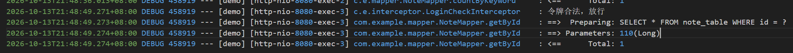
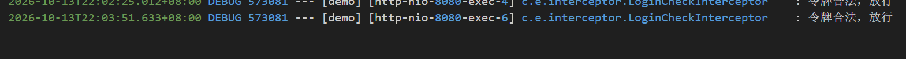
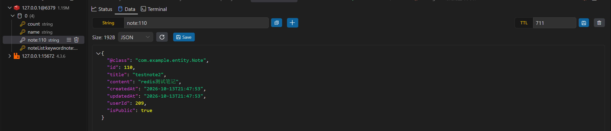
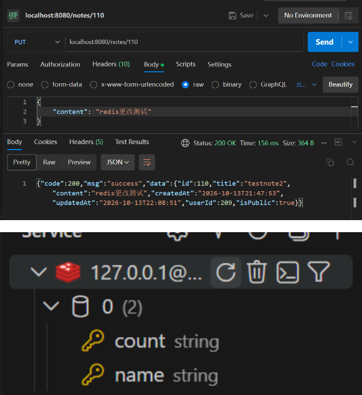

# 缓存

笔记查询是读多写少，同一篇笔记被反复打开。每次都查数据库没必要，所以在 Service 层加了 Redis 缓存。

列表查询用 Spring Cache 的注解，缓存逻辑不侵入业务代码。单篇笔记的查询要另外处理穿透和击穿，注解管不了这两个时机，改成了手写。

涉及的代码：

- `config/RedisCacheConfig.java`
- `config/WebConfig.java`
- `interceptor/RateLimitInterceptor.java`
- `service/NoteService.java`
- `service/UserService.java`

## 一、使用流程

缓存对客户端是透明的，接口怎么调没变化。要看效果得从日志和 Redis 侧面看。

### 1. 第一次查询

调 `GET /notes/{id}`，这次会走数据库。



> 图示：Postman 调 `GET /notes/{id}`，配上日志里对应的 `SELECT * FROM note_table WHERE id = ?`。

### 2. 再查同一个 id

同样调 `GET /notes/{id}`，这次日志里**不会出现 SQL**，直接返回缓存里的数据。



> 图示：再调一次 `GET /notes/{id}`，展示这一次日志里没有 SQL 语句。

### 3. 看 Redis 里的键



> 图示：`redis-cli GET note:{id}`，展示键名和值。

### 4. 更新笔记后再查

调一次 `PUT /notes/{id}`，缓存的键会被清掉。再查同一个 id 又会走库。



> 图示：`redis-cli EXISTS note:{id}` 在更新前后的变化，从 1 变成 0。

## 二、核心逻辑

### 1. 缓存管理器的配置

```java
@Configuration
@EnableCaching
public class RedisCacheConfig {

        @Bean
        public RedisCacheManager cacheManager(RedisConnectionFactory factory) {
                RedisCacheConfiguration config = RedisCacheConfiguration.defaultCacheConfig()
                                .computePrefixWith(cacheName -> cacheName + ":")
                                .entryTtl(Duration.ofMinutes(30))
                                .serializeValuesWith(
                                                RedisSerializationContext.SerializationPair.fromSerializer(
                                                                RedisSerializer.json()));

                return RedisCacheManager.builder(factory)
                                .cacheDefaults(config)
                                .build();
        }
}
```

`@EnableCaching` 打开注解驱动的缓存，没有它 `@Cacheable` 不会生效。

三项配置：

- `computePrefixWith` 把键的前缀从默认的 `cacheName::` 改成 `cacheName:`，所以是 `note:105` 而不是 `note::105`
- `entryTtl` 统一设 30 分钟过期。缓存不设过期时间的话，数据一旦和数据库不一致就会一直错下去
- `serializeValuesWith` 用 JSON 序列化。默认的 JDK 序列化在 Redis 里是一堆二进制，`redis-cli` 看不懂

### 2. 缓存 key 是跨方法的契约

写缓存和清缓存是两处代码，必须指向同一个键名：

```java
// 写：手写，键是字符串拼出来的
String key = "note:" + id;

// 清：注解，键由 SpEL 算出 #id，再加缓存名前缀
@CacheEvict(cacheNames = "note", key = "#id")
```

`@CacheEvict` 加上 `computePrefixWith` 之后算出来的键是 `note:` + `#id`，正好等于手写那个字符串。

**两边一个靠字符串拼接、一个靠表达式，改一处忘了另一处，缓存就会永远清不掉。** 同样的问题在 `update` 和 `changeIsPublic` 上也存在，它们同样用 `#id`。

### 3. condition：哪些查询才走缓存

`condition` 决定**要不要走缓存这条路**，它在方法执行**之前**判断：

```java
@Cacheable(cacheNames = "noteList",
           key = "'usernote:' + #pagesize + ':' + #page + ':' + #userId",
           condition = "#userId != #currentUser")
public PageBean<Note> queryUserNotes(Integer page, Integer pagesize, Long userId, Long currentUser) { ... }
```

`condition` 为假时，这个方法完全不走缓存，直接执行方法体。

这里的意思是：**看别人的笔记列表才缓存，看自己的笔记不缓存。**

看自己的列表时 `userId` 和 `currentUser` 相等，条件为假。这是有意的，因为自己的笔记随时可能改，缓存了要清的地方太多。看别人的列表拿到的是对方的公开笔记，短时间内不会变，适合缓存。

而且 `condition` 为假时也不会往缓存里写，所以缓存里只有别人视角的数据。

### 4. 为什么用 @CacheEvict 而不是 @CachePut

`@CachePut` 是"更新缓存"，看起来更适合用在更新方法上，但这里用的是 `@CacheEvict`。

假设用 `@CachePut` 更新 `note:#id`：

```java
@CachePut(cacheNames = "note", key = "#id")
public Note update(...) { ... }
```

它只会把**当前操作者**这一份缓存刷新掉。但 `note:#id` 这个键是**所有用户共用**的，别人之前查过这篇笔记，他们的请求也写的同一个键。缓存里只有一份，谁来刷都是刷同一份，所以 `@CachePut` 看起来也能用。

真正的问题在 `noteList`。列表缓存按关键字和页码分，键是 `keywordnote:xxx:1:10`，**同一个列表可能被打散成很多个键**，而且新建、删除、改标题都会让所有列表失效。挨个找出来刷新不现实，所以直接清空：

```java
@CacheEvict(cacheNames = "noteList", allEntries = true)
```

`allEntries = true` 表示清掉这个缓存名下的所有键。代价是下次列表查询全部走库，但列表查询本身不慢，换来的是不会出现脏数据。

新建笔记时只清列表，不清 `note`，因为新笔记还没有人缓存过它：

```java
// POST：新建笔记
@CacheEvict(cacheNames = "noteList", allEntries = true)
@Transactional(rollbackFor = Exception.class)
public Note create(Note note, Long userId) { ... }
```

### 5. 删除和更新同时清两个缓存

```java
@Caching(evict = {
        @CacheEvict(cacheNames = "noteList", allEntries = true),
        @CacheEvict(cacheNames = "note", key = "#id")
})
```

`@Caching` 是拿来组合多个缓存注解的。一个方法上不能重复写两个 `@CacheEvict`，要清两个缓存就得这样包一层。

`deleteById`、`update`、`changeIsPublic` 三个方法都是这个写法。

### 6. 单篇笔记为什么改成手写

`getById` 原来也挂着 `@Cacheable`，现在换成了手写。有两个问题注解解决不了。

**穿透**：笔记不存在时方法抛异常，异常路径注解不写缓存，所以同一个不存在的 id 每次都会查库。

**击穿**：注解的缓存写入发生在**方法返回之后**。方法体早就跑完了，没有地方能拦住并发，也没法把「写缓存」圈进锁里。

改成手写之后，拒绝记录、查缓存、抢锁、查库、写缓存、放锁都在方法体里，顺序自己控制。

```java
public Note getById(Long id, Long userId) {
    String key = "note:" + id;

    // 1. 先查拒绝记录，避免缓存穿透
    String denyKey = "note:" + id + ":deny:" + userId;
    if ("NULL".equals(redis.opsForValue().get(denyKey))) {
        throw new BusinessException(404, "资源不存在");
    }

    // 2. 查缓存
    String cached = redis.opsForValue().get(key);
    if (cached != null) {
        return jsonMapper.readValue(cached, Note.class);
    }

    // 3. 加锁，防击穿
    String lockKey = "note:lock:" + id;
    if (!Boolean.TRUE.equals(redis.opsForValue().setIfAbsent(lockKey, "TRUE", Duration.ofSeconds(10)))) {
        try {
            Thread.sleep(100);
        } catch (InterruptedException e) {
            Thread.currentThread().interrupt();
        }
        return getById(id, userId);
    }

    // 4. 查库、写缓存、放锁
    try {
        Note existing = noteMapper.getById(id);
        if (existing == null) {
            redis.opsForValue().set(denyKey, "NULL", Duration.ofMinutes(2));
            throw new BusinessException(404, "资源不存在");
        }
        if (!existing.getIsPublic() && !existing.getUserId().equals(userId)) {
            redis.opsForValue().set(denyKey, "NULL", Duration.ofMinutes(2));
            throw new BusinessException(404, "资源不存在");
        }

        if (existing.getIsPublic()) {
            cached = jsonMapper.writeValueAsString(existing);
            redis.opsForValue().set(key, cached, Duration.ofMinutes(30));
        }

        return existing;
    } finally {
        redis.delete(lockKey);
    }
}
```

原来 `unless = "!#result.isPublic"` 那条规则挪进了方法体：只有公开笔记才写缓存，私密笔记照旧每次走库。

写缓存用 `jsonMapper.writeValueAsString`，不再是 `@Cacheable` 那套序列化，所以 `note:{id}` 里存的是普通 JSON（列表缓存还走注解，格式不一样，见测试部分）。

### 7. 防穿透：拒绝记录

查一个数据库里不存在的 id，方法抛 404。异常路径不写缓存，所以每次请求都会查库。攻击者拿一个不存在的 id 反复请求，就能绕开缓存直接压数据库。

做法是查不到也往 Redis 里写一条记录，键 `note:{id}:deny:{userId}`，值 `NULL`，TTL 2 分钟：

```java
if (existing == null) {
    redis.opsForValue().set(denyKey, "NULL", Duration.ofMinutes(2));
    throw new BusinessException(404, "资源不存在");
}
```

下一次同样的请求进来，第一件事就是查这个键，命中直接返回 404，不碰数据库：

```java
if ("NULL".equals(redis.opsForValue().get(denyKey))) {
    throw new BusinessException(404, "资源不存在");
}
```

**键里为什么要带 `userId`。** 有两条路径会走到 404：

- 笔记根本不存在，这对谁来查都一样
- 笔记存在，但它是私密的，而且不属于你，这条因人而异

同一个 id，作者拿到的应该是 200，别人拿到的才是 404。如果只按 id 缓存拒绝记录，作者本人也会被挡在外面。所以键里带上 `userId`，只拒绝确实该拒绝的那一个人。

**TTL 为什么是 2 分钟。** 拒绝记录是个临时结论。万一数据后来真的产生了，最多 2 分钟就能自愈。

### 8. 防击穿：重建缓存时加锁

热点笔记的缓存到期的那一瞬间，并发的请求会全部 miss，然后一起去查数据库。

```text
缓存到期
  ↓
30 个请求同时到达 → 全部 miss → 30 个全部查库
```

做法是在重建缓存之前先抢一把 Redis 锁，键 `note:lock:{id}`：

```java
String lockKey = "note:lock:" + id;
if (!Boolean.TRUE.equals(redis.opsForValue().setIfAbsent(lockKey, "TRUE", Duration.ofSeconds(10)))) {
    Thread.sleep(100);
    return getById(id, userId);
}
```

`setIfAbsent` 对应 Redis 的 `SET key value NX EX 10`：key 不存在才设置，设置成功即抢到锁。**过期时间不能省。** 只写 SETNX 不设过期，拿到锁的请求挂掉之后锁就永远留在 Redis 里，这条笔记以后谁都查不了。

抢到锁的请求查库、写缓存，然后放锁。没抢到的睡 100 毫秒，再重新走一遍 `getById`，这时候缓存已经被赢家写好了，直接命中返回：

```java
} finally {
    redis.delete(lockKey);
}
```

**写缓存必须在持锁期间。** 先放锁再写缓存的话，等待的请求醒来时缓存还是空的，又会去抢锁，等于白等。

### 9. 限流拦截器

拦截器在 `WebConfig` 里注册，排在登录拦截器后面：

```java
registry.addInterceptor(loginCheckInterceptor)
        .addPathPatterns("/**")
        .excludePathPatterns("/", "/users/login", "/users/register", "/favicon.ico", "/error");
registry.addInterceptor(rateLimitInterceptor).addPathPatterns("/**");
```

顺序不能反。`RateLimitInterceptor` 要读 `request.getAttribute("userId")`，而这个属性是登录拦截器塞进去的，排在前面才拿得到。

计数器按用户分，键 `rate:{userId}`，一分钟 60 次：

```java
String rateKey = "rate:" + userId;

redis.opsForValue().setIfAbsent(rateKey, "0", Duration.ofMinutes(1));
Long count = redis.opsForValue().increment(rateKey);

if (count == 1) {
    redis.expiration(rateKey).expire(Duration.ofMinutes(1));
}

if (count > 60) {
    throw new BusinessException(429, "请求过于频繁");
}
```

`setIfAbsent` 带 TTL 这一步把「建键」和「设过期」绑在一起，键一出生就带过期时间。

`increment` 之后那行 `if (count == 1)` 是兜底：`setIfAbsent` 和 `increment` 之间键有可能刚好到期，这时 `increment` 会把键重新建出来但不带过期时间，而 `count` 正好是 1，补上。

**过期时间只设一次，不在每次请求里续。** 续的话计数器永远不会归零，一直用下去迟早累计到 60 被挡；而且被挡之后每次重试还在续期，只能靠完全静默一分钟才恢复。只设一次才是固定窗口：键在第一次请求时创建，60 秒后过期，计数器归零。

拦截器抛 `BusinessException`，由 `GlobalExceptionHandler` 转成 `{"code":429,"msg":"请求过于频繁"}`，和项目里其它错误的返回格式一致。

`userId` 为空的请求（未登录）直接放行，不计数。

## 三、测试过程与结果

### 1. 列表缓存：连查三次

同一串分页查询连打三次：

```http
GET /notes?page=1&pagesize=3
GET /notes?page=1&pagesize=3
GET /notes?page=1&pagesize=3
```

三次调用只产生了一组 SQL：

```text
NoteMapper.queryByKeyword : ==>  Preparing: SELECT * FROM note_table WHERE is_public = 1 ORDER BY created_at DESC LIMIT ?, ?
NoteMapper.queryByKeyword : ==> Parameters: 0(Integer), 3(Integer)
NoteMapper.queryByKeyword : <==      Total: 3
NoteMapper.countByKeyword : ==>  Preparing: SELECT COUNT(*) FROM note_table WHERE is_public = 1
NoteMapper.countByKeyword : <==      Total: 1
```

后两次没有任何 SQL，说明走了缓存。

Redis 里的键：

```text
noteList:keywordnote:null:1:3
```

键名拆开看：`noteList:` 是 `computePrefixWith` 加的前缀，后面是 `@Cacheable` 里 `key` 表达式算出来的值。关键字为空所以拼成了 `null`，接着是页码和每页条数。

### 2. 单篇缓存：完整的四步

先把 `note:{id}` 删掉，从干净状态开始。

第一步，`GET /notes/{id}`：

```text
走了库吗（SQL 次数）: 1
EXISTS note:{id} = 1
TTL = 1799 秒
```

走了库，同时写进了缓存。TTL 是 1799 秒，说明 30 分钟的过期时间生效了（刚写入时是 1800，读出来少 1 秒）。

第二步和第三步，再查两次：

```text
走了库吗（SQL 次数）: 0
走了库吗（SQL 次数）: 0
```

都没走库。

第四步，`PUT /notes/{id}`：

```text
EXISTS note:{id} = 0
```

更新方法上的 `@CacheEvict` 把键清掉了。

第五步，更新完再查一次：

```text
走了库吗（SQL 次数）: 1
EXISTS note:{id} = 1
```

重新查了库，并且把新的值写回了缓存。

### 3. 缓存里存了什么

`note:{id}` 是手写的，存进去的是 `jsonMapper.writeValueAsString` 出来的普通 JSON：

```json
{"id":110,"title":"testnote2","content":"redis更改测试","createdAt":"2026-10-13T21:47:53","updatedAt":"2026-10-13T22:08:51","userId":209,"isPublic":true}
```

和接口返回的 JSON 一样，没有多余字段。

列表缓存还走 `@Cacheable`，用的是 `RedisSerializer.json()`。那一套会在 JSON 里多写一个 `@class` 字段存类型信息，反序列化时靠它知道该还原成哪个类。

**也因为存了类型信息，列表缓存里的数据结构一旦改了（比如 `Note` 加字段、改类名），旧值反序列化会失败。** 这种时候要么等 TTL 过期，要么手动清掉 Redis 里的键。

两边的格式不一样，但各写各的键，不会互相读到。

### 4. 验证缓存不能直接看 Redis

想知道缓存有没有生效，直接 `KEYS note*` 看键在不在是不可靠的。

原因是写操作上挂着全量清空：

```java
@Caching(evict = {
        @CacheEvict(cacheNames = "noteList", allEntries = true),
        @CacheEvict(cacheNames = "note", key = "#id")
})
```

`allEntries = true` 会清掉整个 `noteList`，同一行又清掉 `note:{id}`。所以只要刚做过一次写操作，两个缓存都是空的，这时候看 Redis 什么也看不到。

**看到空，只能说明刚被清过，不能说明缓存没生效。**

可靠的验证方式是在同一个会话里连着查两次，看第二次有没有产生 SQL：

- 第二次没有 SQL，说明命中缓存
- 两次都有 SQL，说明缓存没生效

这个判断不依赖 Redis 的当前状态，也不受之前做过什么影响。

### 5. 私密笔记每次都走库

方法体里只有 `existing.getIsPublic()` 为真时才写缓存，所以私密笔记查一次走一次库，第二次不会命中。

这是设计上的取舍。私密笔记只有本人看得到，缓存收益本来就低，而一旦可见性变了还要额外去清，索性不缓存。

### 6. 防穿透：拒绝记录挡住重复请求

先把 `note:999999:deny:{userId}` 清掉，然后连打两次同一个不存在的 id：

```text
第一次 PUT /notes/999999
  {"code":404,"msg":"资源不存在","data":null}
  MySQL 查询数：115 → 116

第二次 PUT /notes/999999
  {"code":404,"msg":"资源不存在","data":null}
  MySQL 查询数：116 → 116
```

第一次查了库，写下了拒绝记录。第二次命中拒绝记录直接返回，**一条 SQL 都没有产生**。

拒绝记录本身也在 Redis 里：

```text
note:999999:deny:211
```

### 7. 防击穿：30 个并发只查一次库

先把 `note:111` 从 Redis 里删掉，制造一次缓存 miss，然后同时打 30 次：

```text
响应分布：
     30 "code":200

MySQL 查询总数：+1
```

**30 个并发请求，只有 1 次落到数据库。** 其余 29 个抢锁失败后睡 100 毫秒重新走一遍，醒来时赢家已经把缓存写好了，直接命中返回。

没有请求失败，锁也正常释放了：

```text
note:111 存在? 1
TTL = 1800
残留的锁? 0
```

没有这把锁的话，这 30 次会原封不动全打到数据库。

### 8. 限流：第 61 次开始返回 429

同一个用户连打 65 次：

```text
     60 "code":200
      5 "code":429
```

第 61 次开始被挡。计数器是 `rate:{userId}`，值走到 65。

窗口是固定的，不会因为请求而续期。爆发之后改成每 10 秒发一次，记录每次的返回码和计数器剩余时间：

```text
t=+13s   429   (TTL=48)
t=+23s   429   (TTL=38)
t=+33s   429   (TTL=28)
t=+43s   429   (TTL=18)
t=+53s   429   (TTL=8)
t=+63s   200   (TTL=60)
t=+73s   200   (TTL=50)
```

TTL 那一列一路往下降，说明它没有被每次请求推回去，牢牢锚在第一次请求的 60 秒后。到点键消失，下一次请求把计数器重置成 1，恢复正常。

### 9. 关于 key 的命名

`note` 和 `noteList` 是两个独立的缓存名，前缀分别是 `note:` 和 `noteList:`。因为前缀带冒号，`note:` 开头的键不会和 `noteList:` 混在一起，即使用 `KEYS note*` 查会同时匹配到两者，也能一眼看出属于哪个缓存。
