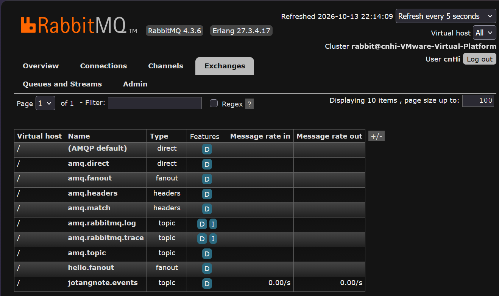
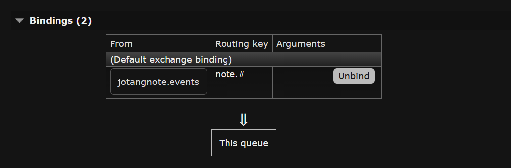
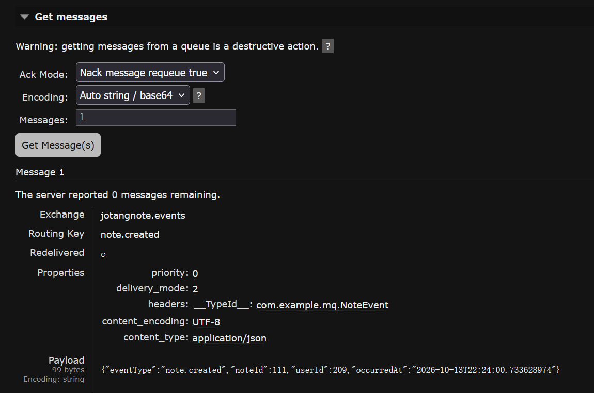
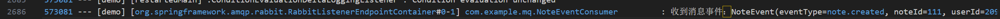

# 消息队列

笔记发生增删改时，除了改数据库，还会往 RabbitMQ 发一条事件消息。

目前只有审计消费者在收，功能上还没承担实际业务。加这一层的目的是把"笔记变了"这件事广播出去，以后要接搜索索引、通知、统计这些功能，直接加消费者就行，不用再动 `NoteService`。

涉及的代码：

- `config/RabbitMQConfig.java`
- `mq/NoteEvent.java`
- `mq/NoteEventConsumer.java`
- `service/NoteService.java` 里的三处发送

## 一、使用流程

消息队列没有对外的接口，看效果要从 RabbitMQ 管理页和日志。

### 1. 管理页里的交换机

打开 `http://localhost:15672`，在 Exchanges 里能看到 `jotangnote.events`，类型是 topic。



> 图示：RabbitMQ 管理页 Exchanges 列表里的 `jotangnote.events`。

### 2. 队列和绑定

Queues 里有 `q.note.audit`。点进去看 Bindings，它绑定在 `jotangnote.events` 上，routing key 是 `note.#`。



> 图示：`q.note.audit` 的详情页，展示绑定关系和 routing key。

### 3. 触发一条消息

新建一篇笔记，然后回到管理页看队列。消息发出去就被消费者取走了，所以队列里通常看不到堆积。



> 图示：新建笔记后队列的收信统计，或者用管理页的 Get Message 取一条出来看内容。

### 4. 消费者日志

后端日志里会出现一行：

```text
收到消息事件：NoteEvent(eventType=note.created, noteId=104, userId=154, occurredAt=2026-10-13T15:48:25.100341219)
```



> 图示：日志文件里那行 `收到消息事件：`。

## 二、核心逻辑

### 1. 三个构件怎么声明

```java
@Configuration
public class RabbitMQConfig {

    @Bean
    Queue noteAuditQueue() {
        return new Queue("q.note.audit");
    }

    @Bean
    TopicExchange noteExchange() {
        return new TopicExchange("jotangnote.events");
    }

    @Bean
    Binding noteAuditBinding(Queue noteAuditQueue, TopicExchange noteExchange) {
        return BindingBuilder.bind(noteAuditQueue).to(noteExchange).with("note.#");
    }
}
```

交换机、队列、绑定各是一个 Bean。`@Bean` 方法的参数按类型自动注入，`noteAuditBinding` 那两个参数不用自己 new，Spring 会把上面两个 Bean 传进来。

绑定用的是 Topic 交换机，routing key 写 `note.#`。`#` 匹配零个或多个单词，所以 `note.created`、`note.updated`、`note.deleted` 都能进这个队列。

选 Topic 而不是 Direct，是为了以后留余地。Direct 要求 routing key 和绑定键完全相等，现在三个事件就得配三个绑定。Topic 一个 `note.#` 全包了，将来要按操作类型拆消费者，加一个 `note.created.*` 之类的绑定就行。

### 2. 队列不是启动就建的

`RabbitAdmin` 负责把 `@Bean` 声明的交换机、队列、绑定真正建到 broker 上，但**它是惰性的**。光在配置类里写 `@Bean Queue` 不会立刻建，要等到第一次建立连接时才发起声明。

第一次连接通常是 `@RabbitListener` 启动时建立的，监听容器要在启动阶段确认队列存在，这时 `RabbitAdmin` 才被触发。

实测中可以直接看到结果，队列的消费者数是 1：

```text
name=q.note.audit  messages=0  consumers=1  durable=true
```

`consumers=1` 说明监听容器已经连上并且声明过队列了。如果只有配置类没有 `@RabbitListener`，队列是不存在的。

### 3. 消息转换器

```java
@Bean
MessageConverter jsonMessageConverter() {
    return new JacksonJsonMessageConverter();
}
```

不配这个的话，默认只支持 `String`、`byte[]` 和 `Serializable`。直接发 `NoteEvent` 这种 POJO 会报错，因为它不是 `Serializable`。

配了之后，发送时自动把对象转成 JSON 放进消息体，接收时自动转回对象。所以消费者那边写的是 `handle(NoteEvent event)`，不用自己解析 JSON。

一个版本差异：Spring AMQP 4 里类名是 `JacksonJsonMessageConverter`，旧版本叫 `Jackson2JsonMessageConverter`，带一个 `2`。照抄旧资料会找不到这个类。

### 4. 消息体为什么这么设计

```java
@Data
@NoArgsConstructor          // 反序列化需要无参构造
@AllArgsConstructor
public class NoteEvent {
    private String eventType;           // note.created / updated / deleted
    private Long noteId;
    private Long userId;
    private LocalDateTime occurredAt;   // 事件发生的时间
}
```

这是**事件式**的消息，不是命令式。

事件式说的是"note.created 这件事发生了"，只描述事实。命令式会说"请去建一条搜索索引"，直接指挥消费者做事。

区别在于生产者要不要知道消费者是谁。事件式的生产者只管喊一嗓子，谁想听谁听，加新消费者不用改生产者。命令式则要求生产者知道每个消费者要干什么，加一个就得回来改一次发送逻辑。

`eventType` 字段和 routing key 是同一个值，但作用不同。routing key 给 broker 用来路由，`eventType` 给消费者读，两个都留着。

`@NoArgsConstructor` 是必须的。消息转换器要把 JSON 转回对象，得先造一个空对象再往字段里填，没有无参构造会失败。`@AllArgsConstructor` 是方便发送方写：

```java
NoteEvent event = new NoteEvent("note.created", note.getId(), userId, LocalDateTime.now());
rabbitTemplate.convertAndSend("jotangnote.events", "note.created", event);
```

### 5. 消费者

```java
@Slf4j
@Component
public class NoteEventConsumer {
    @RabbitListener(queues = "q.note.audit")
    public void handle(NoteEvent event) {
        log.info("收到消息事件：{}", event);
    }
}
```

`@RabbitListener` 标在方法上，Spring 会为它维护一个监听容器。消息到达时容器在**独立线程**里调用这个方法，和 HTTP 请求的线程是分开的，所以消费是异步的。

队列名直接写在注解里，没有引用配置类里的那个 `Queue` Bean，两处是同一个字符串 `q.note.audit`。写错一个字母不会编译报错，要等跑起来收不到消息才发现。

### 6. 三个事件

`NoteService` 里三处发送，对应三种操作：

- `create` 发 `note.created`
- `update` 发 `note.updated`
- `deleteById` 发 `note.deleted`

发送用的都是 `rabbitTemplate.convertAndSend(交换机, routing key, 消息体)`，交换机固定是 `jotangnote.events`，routing key 和 `eventType` 保持一致。

`changeIsPublic` 没有发消息。切换可见性也是一种更新，但它没有对应的 `eventType`，暂时没纳入。

### 7. 写操作为什么同步执行

笔记的增删改都是同步落库，落库之后再发一条事件消息。**操作本身没有放进 MQ。**

另一种做法是把操作也做成消息：接口收到请求后不碰数据库，直接把「创建笔记」这件事投进队列就返回；消费者拿到消息再去插库。

没有这么做，原因有三条。

**用户需要立刻拿到结果。** 创建笔记后要跳转到详情页，需要新笔记的 id；修改后要看到新内容。异步之后接口只能返回已受理，这两个都用不了。

**操作本身很轻。** 一条 INSERT 一两毫秒，走 MQ 反而多出序列化、broker 往返、消费者调度这些开销，比同步更慢。

**失败需要立刻反馈。** 参数不合法、笔记不存在、无权操作，同步路径上能直接返回对应的错误码；异步之后请求已经返回成功，错误只能落在日志里，用户看不到。

分界线是**用户要不要立刻拿到结果**。需要就同步，不需要才轮到 MQ——下单、支付、转码、发短信这类耗时长或者不需要立刻返回的，才适合把操作本身交给队列。

MQ 在这里负责下游：笔记变更之后广播出去，别的逻辑自己决定要不要处理。审计消费者挂在这条线上，以后加搜索索引、通知、统计也一样，加消费者不用改 `NoteService`。

## 三、测试过程与结果

### 1. 队列的声明情况

通过管理 API 查队列：

```http
GET http://localhost:15672/api/queues/%2F/q.note.audit
```

结果：

```text
name=q.note.audit  messages=0  consumers=1  durable=true
```

- `consumers=1` 说明 `@RabbitListener` 已经启动，监听容器连上了队列
- `messages=0` 说明当前没有堆积，消息发出去就被消费掉了
- `durable=true` 说明队列是持久化的，broker 重启后队列还在（这是 `new Queue(name)` 的默认行为）

### 2. 新建笔记触发的事件

```http
POST /notes
body: {"title":"文档测试笔记","content":"这是为写说明文档创建的测试数据，测完会删除。"}
```

操作日志和消费者日志出现在同一个时间窗口内：

```text
2026-10-13T15:48:25.120 INFO  OperationLogAspect : [操作] 用户id=154 用户名=webtest 操作=新建笔记 方法=NoteController.create(..) 耗时=42ms
2026-10-13T15:48:25.131 INFO  NoteEventConsumer : 收到消息事件：NoteEvent(eventType=note.created, noteId=104, userId=154, occurredAt=2026-10-13T15:48:25.100341219)
```

两行之间差 11 毫秒，而且线程名不一样：

- 操作日志跑在 `[http-nio-8080-exec-10]`，是处理 HTTP 请求的线程
- 消费者日志跑在 `[RabbitListenerEndpointContainer#0-1]`，是监听容器自己的线程

这直接印证了消费是异步的。HTTP 请求在 15:48:25.120 就返回了，消费者的日志晚了 11 毫秒，两条时间线互不阻塞。

消费者收到的对象里四个字段都有值：`eventType=note.created`、`noteId=104`、`userId=154`、`occurredAt` 是事件发生的时间。

`noteId=104` 是数据库自增出来的主键，说明 `useGeneratedKeys` 把 id 回填到对象上了，否则 `note.getId()` 会是 null。

### 3. 更新笔记触发的事件

```http
PUT /notes/104
body: {"title":"文档测试笔记（已改标题）","content":"正文也改了。"}
```

```text
2026-10-13T15:48:26.798 INFO  NoteEventConsumer : 收到消息事件：NoteEvent(eventType=note.updated, noteId=104, userId=154, occurredAt=2026-10-13T15:48:26.798977627)
2026-10-13T15:48:26.807 INFO  OperationLogAspect : [操作] 用户id=154 用户名=webtest 操作=更新笔记内容 方法=NoteController.update(..) 耗时=15ms
```

这次消费者日志比操作日志**早 9 毫秒**，`occurredAt` 和消费者收到的时间只差不到 1 毫秒。

顺序反过来是正常的。发消息和记操作日志是两个独立动作，谁先在日志文件里落盘没有保证。不要靠日志顺序去推断执行顺序。

### 4. 删除笔记触发的事件

```http
DELETE /notes/107
```

```text
2026-10-13T16:32:56.651 INFO  NoteEventConsumer : 收到消息事件：NoteEvent(eventType=note.deleted, noteId=107, userId=154, occurredAt=2026-10-13T16:32:56.649574031)
2026-10-13T16:32:56.652 INFO  OperationLogAspect : [操作] 用户id=154 用户名=webtest 操作=删除指定笔记 方法=NoteController.deleteById(..) 耗时=6ms
```

三个事件类型都在实测中出现过，routing key 都是 `note.*` 的形式，能被 `note.#` 这个绑定接住。

### 5. 队列不堆积

跑到最后查一次队列状态，`messages` 仍然是 0。消费者一直在监听，消息进来立刻被取走，所以管理页上看不到堆积。

想看到消息留在队列里，得先把后端的监听停掉再发消息。这个没测，因为要重启服务。
