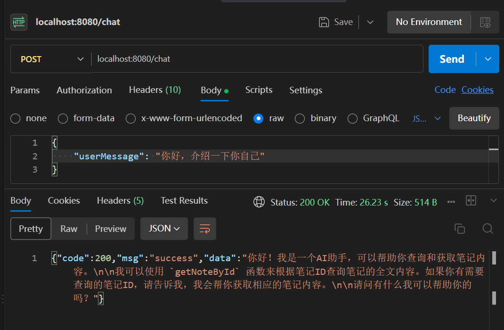
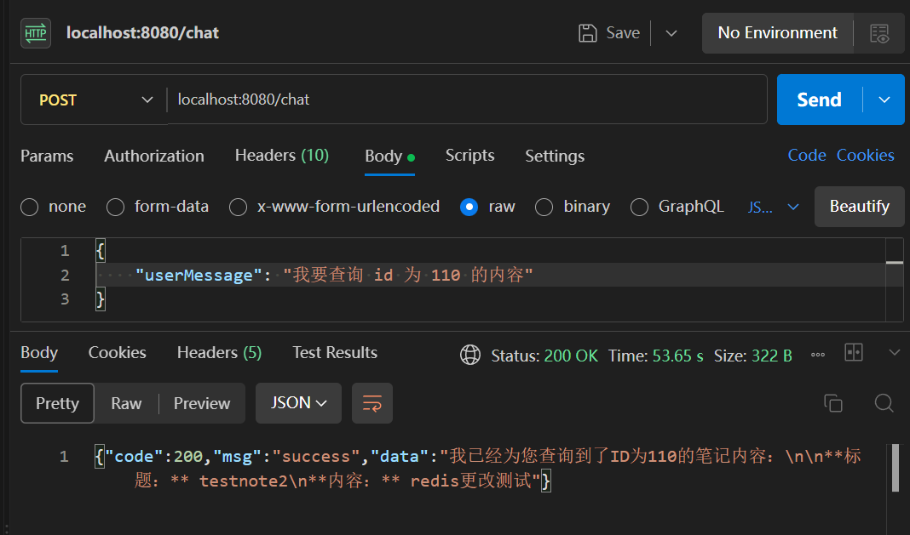
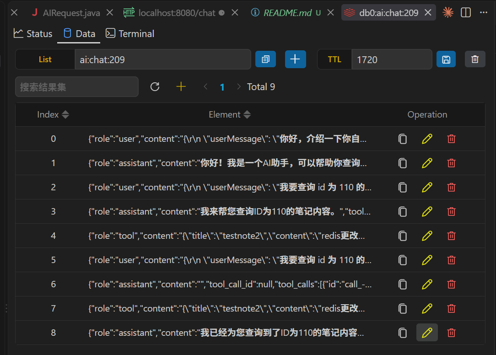

# AI 助手

AI 助手提供两个能力：记住上下文的多轮对话，以及让模型查询笔记全文。

上下文由后端存在 Redis 里，按用户隔离。模型本身不保存任何状态，所谓"记得"是每轮把历史重新发过去。工具调用让模型能读到笔记正文，这样它才能回答"第几篇写了什么"这类问题。

涉及的代码：

- `controller/AIController.java`
- `service/AIService.java`
- `aidto/AIMessage.java`、`AIRequest.java`、`AIResponse.java`
- `aidto/tools/AIToolCall.java`、`AIToolDefinition.java`、`ToolList.java`

## 一、使用流程

### 1. 普通问答

发 `POST /chat`，请求体是一段 JSON：

```http
POST /chat
token: eyJhbGciOiJIUzI1NiJ9...
Content-Type: application/json

{
    "userMessage": "你好，介绍一下你自己"
}
```

返回的 `data` 就是模型回复的文本。

这里有个容易误解的地方。**后端并没有一个叫 `userMessage` 的 DTO**，参数类型是 `String`，Spring 拿到的是原始请求体文本。所以上面那段 JSON 是整串（连同花括号和换行）被当成用户消息发给模型的，不是只取了 `userMessage` 的值。具体在核心逻辑那节展开。



> 图示：Postman 调 `POST /chat`，展示请求体和返回的回复。

### 2. 问笔记相关的问题

问一句涉及具体笔记的话，模型会自己决定去查：

```json
{
    "userMessage": "我要查询 id 为 110 的内容"
}
```



> 图示：Postman 调 `POST /chat` 问某篇笔记的内容，展示回复。

模型查不到的时候不会报错，会把"资源不存在"当成查询结果，然后自己组织一句话回你。

### 3. 会话上下文

同一个用户连续发多条消息，模型能接上。历史存在 Redis 的 `ai:chat:{userId}` 里，30 分钟不用会自动清掉。



> 图示：`redis-cli LRANGE ai:chat:{userId} 0 -1`，展示完整的消息序列。

## 二、核心逻辑

### 1. 手写 HTTP，不引 SDK

项目里没引任何 AI 相关的 SDK，用的是 Spring 自带的 `RestClient`：

```java
this.restClient = RestClient.builder().baseUrl(baseUrl).build();
```

```java
AIResponse response = restClient.post()
        .uri("/chat/completions")
        .header("Authorization", "Bearer " + apiKey)
        .body(request)
        .retrieve()
        .body(AIResponse.class);
```

智谱提供的接口是 OpenAI 兼容的，请求和响应都是普通 JSON，没必要为它单独加一个依赖。

认证头是 `Authorization: Bearer <key>`。**Bearer 和 key 中间那个空格不能少**，少了会返回 401。

`baseUrl` 和 `apiKey` 从配置读：

```properties
ai.api-key=${JOTANGNOTE_API_KEY:}
ai.base-url=https://open.bigmodel.cn/api/paas/v4
ai.model=glm-4.7-flash
```

key 写成了 `${JOTANGNOTE_API_KEY:}`，实际值放在环境变量，代码里和仓库里都不出现。

### 2. 请求体拿到的是原始文本

Controller 的签名是：

```java
@PostMapping
public Result<String> chat(@RequestBody String userMessage,
        @RequestAttribute("userId") Long userId) {
    String response = aiService.chat(userMessage, userId);
    return Result.success(response);
}
```

参数类型是 `String`，Spring 会用 `StringHttpMessageConverter` 处理它，**直接把请求体原文交出去**，不会当成 JSON 解析。

所以发：

```json
{
    "userMessage": "你好，介绍一下你自己"
}
```

`userMessage` 变量的值不是 `你好，介绍一下你自己`，而是**整段文本**：

```text
{\r\n    "userMessage": "你好，介绍一下你自己"\r\n}
```

连花括号和缩进都在里面。这个串会原样发给模型。

从 Redis 里存的会话能直接看到这件事：

```text
role=user  content="{\r\n    \"userMessage\": \"你好，介绍一下你自己\"\r\n}"
```

模型能答对，是因为它足够聪明，能从这段 JSON 里把真正的问题挑出来。

这是接口契约不明确带来的问题。`@RequestBody String` 只声明了"要一个字符串"，没有约束客户端该发什么格式。两种写法都能进来，落到模型手上的却不是同一种东西。

两种收敛方式：

- 参数改成带 `userMessage` 字段的 DTO。Spring 用 Jackson 解析，取到的就是干净的字符串，格式由类型定死，传错了在入口直接 400
- 客户端统一发 `text/plain` 的纯文本。`StringHttpMessageConverter` 同样接得住，消息内容就是原文

第一种更严谨，格式错误在入口就被挡住；第二种改动小，但依赖客户端自觉。

### 3. 关掉思考过程

`AIRequest` 的构造方法里固定塞了一个 `thinking` 字段：

```java
public AIRequest(String model, List<AIMessage> messages) {
    this.model = model;
    this.messages = messages;
    this.tools = ToolList.ALL;
    this.thinking = new Thinking();
}

public static class Thinking {
    private String type = "disabled";
}
```

glm 的模型默认会先输出一段思考过程再给答案。这段过程会计入 output token，也就会计费，而且会明显拖慢响应。

实测把这个字段带上之后，同一个问题的 completion token 从 151 降到 2，耗时从 2588 毫秒降到 504 毫秒。

`AIRequest` 里同时还自动填了 `tools`，每次请求都会把 `ToolList.ALL` 一起发过去，不用在调用处重复写。

### 4. 会话上下文存在 Redis 的 List 里

```java
private static final String KEY_PREFIX = "ai:chat:";

// 将新消息添加到缓存
private void conversationRedis(String key, AIMessage aiMessage) {
    String jsonMessage = jsonMapper.writeValueAsString(aiMessage);
    redis.opsForList().rightPush(key, jsonMessage);
    redis.opsForList().trim(key, -20, -1);
    redis.expire(key, Duration.ofMinutes(30));
}
```

三件事：

- `rightPush` 从列表右边追加。读的时候 `range(key, 0, -1)` 从左边开始取，顺序正好和对话顺序一致
- `trim(key, -20, -1)` 只保留最后 20 条，防止历史无限增长
- `expire` 设 30 分钟，用户不说话了自动清掉

**方法收的是整个 `AIMessage` 对象，不是 role 加 content 两个字符串。** 这一点很关键，下面讲工具调用时会看到原因。

key 按 userId 分开，`ai:chat:207` 只属于 id 为 207 的用户，互相看不到对方的对话。

用 List 是因为对话本身就是先进先出，天然对口。缺点每次都要把整段历史读出来再全部发过去，对话长了会浪费。

### 5. 工具调用要两轮请求

模型不能直接访问数据库。它能做的是"提出一个调用请求"，真正执行的还是后端的代码。

第一轮，把用户问题和工具定义一起发过去：

```java
Map.of(
        "type", "object",
        "properties", Map.of(
                "id", Map.of("type", "integer", "description", "笔记ID")),
        "required", List.of("id"))
```

这段是 JSON Schema，描述参数的形状。`name` 和 `description` 是给模型看的，它靠这两项判断什么时候该调、要传什么参数，所以描述要写清楚。

模型不会直接回答，而是返回一个 `tool_calls`。后端的处理循环：

```java
for (int i = 0; i < MAX_ROUND; i++) {
    AIRequest request = new AIRequest(model, messages);
    AIMessage aiMessage = callModel(request);

    messages.add(aiMessage);
    conversationRedis(key, aiMessage);

    // 检查有无工具调用，无工具调用直接输出ai回复
    if (aiMessage.getTool_calls() == null) {
        return aiMessage.getContent();
    }

    // 有调用需求，获取回复中的参数，调用请求的方法
    for (AIToolCall aiToolCall : aiMessage.getTool_calls()) {
        JsonNode arguments = jsonMapper.readTree(aiToolCall.getFunction().getArguments()); // 反序列化参数
        ...
    }
}
```

判断结束的依据是 `tool_calls` 是不是空。空就说明这轮是最终回答，直接返回。

`MAX_ROUND = 5` 是兜底。模型有可能一直要求调工具停不下来，加个上限防止死循环。

有两个地方容易踩：

**第一，`arguments` 是一个 JSON 字符串，不是对象。**

从实测抓到的原始消息看：

```json
{"id":"call_-7181619179328372457","type":"function","function":{"name":"getNoteById","arguments":"{\"id\":108}"}}
```

`arguments` 的值是被转义过的字符串 `"{\"id\":108}"`，得先 `readTree` 解析才能取到 id。

**第二，工具执行失败不能让异常冒出去。**

```java
String toolResult;
try {
    Note toolReturned = noteService.getById(arguments.path("id").asLong(0), userId);
    toolResult = jsonMapper.writeValueAsString(Map.of(
            "title", toolReturned.getTitle(),
            "content", toolReturned.getContent()));
} catch (BusinessException e) {
    toolResult = jsonMapper.writeValueAsString(Map.of("error", e.getMessage()));
}
```

模型可能会瞎编一个不存在的 id，也可能拿到别人私密笔记的 id，这些都会让 `getById` 抛异常。

如果不接住，异常直接冒到最外面，这一轮对话就废了。接住之后把错误当成查询结果回传，模型看到 `{"error":"资源不存在"}` 会自己组织一句"没找到这篇笔记"，对话还能继续。

`userId` 是从会话里取的，**没有放进工具参数里**。如果让模型自己传 `userId`，它就能去查别人的笔记了。模型给的参数一律当不可信输入处理。

### 6. 消息序列必须配对

一轮完整的工具调用会在历史里留下四条消息：

```text
user      帮我看看第 108 篇笔记写了什么
assistant tool_calls = getNoteById({"id":108})
tool      {"title":"我的养猫日记",...}   tool_call_id = call_-7181619179328372457
assistant 第108篇笔记是《我的养猫日记》，内容是：...
```

这四条是一条链，缺一不可。

OpenAI 兼容接口规定：**每条 `tool` 消息必须带 `tool_call_id`，且要和紧邻的前一条 assistant 消息里 `tool_calls[].id` 对得上。**

所以缓存里存的必须是**完整的消息对象**，不能只存 role 和 content。早先的写法是：

```java
private void conversationRedis(String key, String role, String content) {
    String jsonMessage = jsonMapper.writeValueAsString(new AIMessage(role, content));
    ...
}
```

这样构造出来的 `AIMessage`，`tool_calls` 和 `tool_call_id` 一直是 null。存进缓存后，第二轮读回来的 assistant 消息没有 `tool_calls`，tool 消息没有 `tool_call_id`，整条链断掉，接口会直接报 400。

改成收整个对象之后就没这个问题了，调用处直接把要加进 `messages` 的那个对象原样传进来，两边永远一致。

还有一个相关的地方，历史被 `trim` 截断时可能从中间切开：

```java
for (String message : existing) {
    AIMessage pastMessage = jsonMapper.readValue(message, AIMessage.class);
    if (!messages.isEmpty() || pastMessage.getRole().equals("user")) {
        messages.add(pastMessage);
    }
}
```

`trim` 只按条数保留最后 20 条，不管消息之间的配对关系。如果截断点正好落在 assistant 和它的 tool 之间，读回来第一条就是孤立的 tool 消息，同样非法。

这段循环的作用是**丢掉开头不是 user 的消息**。`messages` 还空的时候只有 `user` 能进来，一旦进来一条，后面就全都保留。这样无论从哪里截断，读回来都是从一条 user 开始的完整对话。

### 7. 限流时退避重试

```java
for (int attempt = 1;; attempt++) {
    try {
        ...
    } catch (HttpClientErrorException.TooManyRequests e) {
        log.warn("模型访问频繁，第 {} 次重试", attempt);
        if (attempt >= MAX_ATTEMPTS) {
            throw new BusinessException(429, "模型当前访问量过大，请稍后再试");
        }
        try {
            Thread.sleep(Duration.ofSeconds(attempt));
        } catch (InterruptedException e1) {
            Thread.currentThread().interrupt(); // 恢复中断标志
            throw new BusinessException(500, "请求被中断");
        }
    }
}
```

`MAX_ATTEMPTS = 3`，等待时间按尝试次数递增，第一次 1 秒，第二次 2 秒。

逐次加长是为了给对面恢复的时间，也避免自己一直在打。重试三次还是失败就抛 `BusinessException(429)`，前端提示用户稍后再试。

`InterruptedException` 被捕获后调了 `Thread.currentThread().interrupt()` 把中断标志恢复回去。吞掉这个异常不恢复标志的话，上层就不知道这个线程被要求中断了。

## 三、测试过程与结果

### 1. 普通问答的响应与耗时

```http
POST /chat
Content-Type: application/json

{
    "userMessage": "你好，介绍一下你自己"
}
```

响应：

```json
{"code":200,"msg":"success","data":"你好！我是一个AI助手，可以帮助你查询和获取笔记内容。\n\n我可以使用 `getNoteById` 函数来根据笔记ID查询笔记的全文内容。如果你有需要查询的笔记ID，请告诉我，我会帮你获取相应的笔记内容。\n\n请问有什么我可以帮助你的吗？"}
```

耗时 26.23 秒，响应体 514 字节。

模型在回答里主动提到了 `getNoteById`，说明工具定义确实随请求发过去了，模型知道自己手上有哪些工具可用。

这个耗时比直接打模型 API 长得多。单独测同一个接口是 504 毫秒，慢的部分全在模型侧的排队上，和本项目的代码无关。

### 2. 触发工具调用

```http
POST /chat
Content-Type: application/json

{
    "userMessage": "我要查询 id 为 110 的内容"
}
```

响应：

```json
{"code":200,"msg":"success","data":"我已经为您查询到了ID为110的笔记内容：\n\n**标题：** testnote2\n**内容：** redis更改测试"}
```

耗时 53.65 秒，响应体 322 字节。

`testnote2` 和 `redis更改测试` 都是库里的真实数据，模型编不出来，说明它确实读到了这篇笔记。

后端执行了这次查询，日志里能查到：

```text
NoteMapper.getById : ==>  Preparing: SELECT * FROM note_table WHERE id = ?
NoteMapper.getById : ==> Parameters: 110(Long)
NoteMapper.getById : <==      Total: 1
```

这条日志是**工具执行**产生的，不是模型产生的。模型只负责说"我要查 110"，查库是后端做的。

### 3. Redis 里的完整消息序列

`ai:chat:209` 里存着 9 条：

```text
[0] role=user      content="{\r\n    \"userMessage\": \"你好，介绍一下你自己\"\r\n}"
[1] role=assistant content="你好！我是一个AI助手，可以帮助你查询和获取笔记内容。..."
[2] role=user      content="{\r\n    \"userMessage\": \"我要查询 id 为 110 的内容\"\r\n}"
[3] role=assistant content="我来帮您查询ID为110的笔记内容。"  tool_calls=getNoteById({"id":110})
[4] role=tool      content="{\"title\":\"testnote2\",\"content\":\"redis更改测试\"}"  tool_call_id=call_-7181518127337831797
[5] role=user      content="{\r\n    \"userMessage\": \"我要查询 id 为 110 的内容\"\r\n}"
[6] role=assistant content=""  tool_calls=getNoteById({"id":110})
[7] role=tool      content="{\"title\":\"testnote2\",\"content\":\"redis更改测试\"}"  tool_call_id=call_-7181486104061668899
[8] role=assistant content="我已经为您查询到了ID为110的笔记内容：..."
```

几个看点。

第 0 条和第 2 条的 content 是**整段 JSON**，花括号、`\r\n`、缩进都在里面。这直接印证了前面说的"后端拿到的是原始请求体"。

第 3 条和第 4 条是一组配对。assistant 提出要调 `getNoteById`，tool 把结果回传，两个 id 都是 `call_-7181518127337831797`。

但 **第 3 条到第 4 条之后，直接接了第 5 条一条新的 user 消息**。这一轮工具执行完了，模型还没来得及把结果组织成答复，请求就结束了。

第 5 条和第 2 条内容完全一样，是重新问了一遍。真正走完的是第 5 到第 8 条这一轮。

第 3、4 条那半截为什么没走完，光看会话看不出来。可能是请求被客户端中断，也可能是模型调用报错。从消息序列本身看它是**合法**的，`tool` 消息和前面的 `tool_calls` 对得上，配对没断，所以后面的对话不受影响。

不过 第 2 条和第 5 条这种重复会一直留在历史里。历史每一轮都要原样发给模型，重复的用户消息既占 token，也让上下文变得啰嗦。

把 第 6 条和第 7 条原样打出来：

```json
{"role":"assistant","content":"","tool_call_id":null,"tool_calls":[{"id":"call_-7181486104061668899","type":"function","function":{"name":"getNoteById","arguments":"{\"id\":110}"}}]}
```

```json
{"role":"tool","content":"{\"title\":\"testnote2\",\"content\":\"redis更改测试\"}","tool_call_id":"call_-7181486104061668899","tool_calls":null}
```

两条的 id 都是 `call_-7181486104061668899`，对得上。

`tool` 那条的 `content` 是后端拼的，只取了 `title` 和 `content` 两个字段，没把整个 Note 发过去。`userId`、`createdAt` 这些模型用不上，没必要占 token。

`assistant` 那条的 `content` 是空字符串而不是 null，输出全在 `tool_calls` 里。这一点和 [3] 不同，[3] 的 `content` 有值。空不空取决于模型当轮怎么输出，不是固定的。

序列一共 9 条，离 `trim` 的上限 20 条还远。要走到截断，得让历史超过 20 条，那时开头那段过滤才会被触发到。

### 4. 限流时的行为

模型被限流时，接口的返回是：

```json
{"code":429,"msg":"模型当前访问量过大，请稍后再试","data":null}
```

耗时 3.44 秒，正好是三次重试的总等待时间（1 秒加 2 秒，加上三次请求本身的开销）。

日志：

```text
AIService : 模型访问频繁，第 1 次重试
AIService : 模型访问频繁，第 2 次重试
AIService : 模型访问频繁，第 3 次重试
GlobalExceptionHandler : 业务异常: code=429, msg=模型当前访问量过大，请稍后再试
```

三次都有记录，最后交给全局异常处理器转成统一的 `Result` 形状返回。

这个 429 是模型服务商的容量限制，和本项目的代码无关。免费模型在高峰期几乎必然撞上。

### 5. 测试期间遇到的现象

- 同一个问题连着试几次，有时成功有时 429，没有规律。这不是接口的问题，是模型侧的实际可用性
- 成功的那次工具调用耗时 53.65 秒，比普通问答的 26.23 秒长。因为要两轮请求，每一轮都可能排队
- 单次调用耗时在 20 到 65 秒之间波动，同一个问题隔一会儿再问可能差一倍。排队时间由模型服务商决定，客户端和服务端都左右不了
