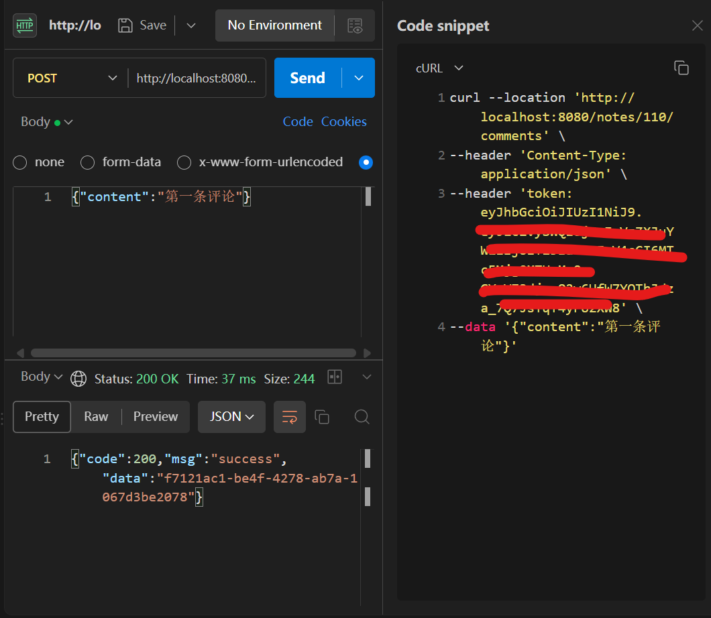
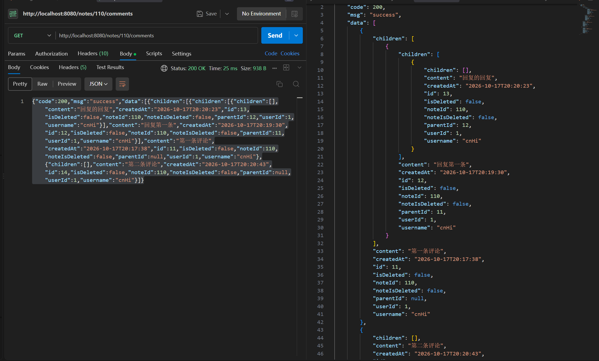

# 评论

笔记支持多级嵌套评论。回复可以一直往下挂，层级不限，前端按树递归渲染。

写操作走 MQ 异步落库：接口收到请求后只做校验和投递，立刻返回一个受理号，真正的入库由消费者完成。

涉及的代码：

- `controller/CommentController.java`
- `service/CommentService.java`
- `mapper/CommentMapper.java`、`CommentMapper.xml`
- `mq/CommentCommand.java`
- `mq/CommentCommandConsumer.java`
- `config/RabbitMQConfig.java`
- `mq/NoteEventConsumer.java`、`service/NoteService.java`（级联软删）

## 一、使用流程

### 1. 发一条评论

请求体只需要用户填的内容，`noteId` 在路径上，评论者和用户名由服务端从 token 里取。

```json
POST /notes/110/comments
{"content": "第一条评论"}
```

接口不返回评论对象，返回一个事件 id：

```json
{"code":200,"msg":"success","data":"995be0b5-16ce-4f64-8223-a97f9360dcce"}
```



> 图示：Postman 调 `POST /notes/{id}/comments`，展示请求体和返回的 eventId。

### 2. 回复某条评论

多带一个 `parentId`，指向被回复的评论：

```json
{"content": "同意", "parentId": 5}
```

`parentId` 为空就是一级评论。父评论必须是同一篇笔记底下的，而且不能已经被删除。

### 3. 查看评论树

```http
GET /notes/110/comments
```

返回的顶层数组里是**树根**，每个节点通过 `children` 往下挂。顶层可能只有一两个元素，但整棵树都在里面。



> 图示：`GET /notes/{id}/comments` 的返回，展示嵌套的 children 结构。

### 4. 删除一条评论

```http
DELETE /notes/110/comments/5
```

同样是异步的，返回一个事件 id。落库之后这条评论变成已删除状态，**但它下面的回复仍然在**。

### 5. 删除笔记之后

笔记被删除时，它底下的所有评论会被一起标记。笔记本身是真删，评论是软删——因为评论有树形结构，硬删会把整棵子树打断。

### 6. 权限

- 没带 token 的请求一律 401
- 删除别人的评论返回 403
- 路径里的 `noteId` 和评论自身的笔记对不上，返回 404
- 给别人的私密笔记发评论，返回 404（和读笔记时一致，不暴露私密笔记的存在）

## 二、核心逻辑

### 1. 数据结构：邻接表

```sql
CREATE TABLE comment_table (
    id BIGINT PRIMARY KEY AUTO_INCREMENT,
    note_id BIGINT NOT NULL,
    user_id BIGINT NOT NULL,
    username VARCHAR(50) NOT NULL,
    parent_id BIGINT,
    content text NOT NULL,
    created_at DATETIME NOT NULL,
    is_deleted BOOLEAN NOT NULL DEFAULT 0,
    note_is_deleted BOOLEAN NOT NULL DEFAULT 0,
    KEY idx_note_id (note_id)
);
```

层级关系只靠 `parent_id` 这一个字段表示，`NULL` 就是一级评论。数据库里存的是一张平表，树是在内存里连出来的。

没有用路径枚举或者闭包表。一篇笔记的评论量不大，按 `note_id` 一次全取、在内存里建树完全够用，也不用维护额外的字段。

**`note_id` 上加了索引**，因为查评论的唯一路径就是"按 note_id 把这篇笔记的评论全取出来"。

**两个删除标记是分开的：**

- `is_deleted` 表示评论作者自己删的
- `note_is_deleted` 表示所属笔记被删了，评论跟着标记

分开是为了以后能区分"这条评论本来就被作者删了"和"它是被笔记删除带走的"。

### 2. 建树

```java
List<Comment> all = commentMapper.getByNoteId(noteId);

Map<Long, Comment> map = new HashMap<>();
List<Comment> roots = new ArrayList<>();

for (Comment c : all) {
    map.put(c.getId(), c);
}

for (Comment c : all) {
    if (c.getParentId() == null) {
        roots.add(c);
    } else {
        Comment parent = map.get(c.getParentId());
        if (parent != null) {
            parent.getChildren().add(c);
        }
    }
}
```

分两趟：先把所有节点放进 Map，再按 `parent_id` 挂到父节点上。

`Comment` 里 `children` 装的是**对象引用**，不是 id。所以连完之后 `roots` 里虽然只有几个元素，但顺着 `children` 往下走能到全部节点。Jackson 序列化时也会顺着走，最终响应体里是完整的嵌套结构。

**排序依赖 `ORDER BY created_at ASC, id ASC`。** 子评论一定晚于父评论创建，所以按时间升序时父节点一定排在前面。`id` 是用来兜底的——`created_at` 是 DATETIME，只精确到秒，同一秒内的几条靠自增 id 区分先后。

**找不到父节点时不能直接 `.getChildren()`**，会空指针。正常情况不会发生（父评论被软删了，但节点还在列表里），但数据被手工改过就会出现。

### 3. 软删除保留结构

已删除的评论不返回内容：

```java
if (comment.getIsDeleted()) {
    comment.setContent(null);
    comment.setUsername(null);
}
```

节点本身留在树上，前端渲染成"该评论已删除"，然后**继续往下渲染它的 children**。

这是软删除换来的东西。硬删除的话，删掉中间一层，它下面的回复要么一起删掉，要么得重新挂到爷爷节点上，两种都不理想。

### 4. 发评论为什么走 MQ

评论的写入频率比笔记高——一篇热门笔记底下可能同时有很多人在发。异步化是为了削峰：接口只负责校验和投递，把实际入库的节奏交给消费者控制。

代价是接口拿不到真实的评论对象。返回的 `eventId` 是受理号，前端要靠它和后续拉到的数据对上。

**校验放在投递之前**，包括笔记可见性、内容非空、父评论合法性。放在前面，参数错误能同步返回 400；放到消费者里，接口已经返回成功，错误只能落进日志。

### 5. 消息体为什么包一层

```java
public class CommentCommand {
    private String eventId;
    private String eventType;
    private Comment comment;
    private LocalDateTime occurredAt;
    private Long userId;
    private String username;
}
```

外层是"信封"，里面装着"载荷"。

**创建和删除必须共用一个消息类型。** 一个队列只能挂一个消费者方法——拆成两个方法会开两个消费者容器并发拉同一个队列，顺序当场就没了。所以两种操作共用 `CommentCommand`，靠 `eventType` 区分。

**`eventId` 只能放在信封里。** 它是生产者生成的幂等键，而 `comment.id` 是异步入库之后才有的，投递的时候还不存在。

**删除操作的载荷只有一个 id。** 消费者在 `comment.deleted` 分支里只读 `getId()`，其余字段不碰。

**`userId` 和 `username` 在信封和载荷里各存了一份。** 是为了让 `default` 分支打日志时不用碰 `comment`——不认识的 `eventType` 对应的载荷可能是 null，碰了就空指针。

### 6. 幂等：eventId 去重

消费者开头先查这个事件有没有处理过：

```java
String eventKey = "mq:event:" + command.getEventId();
if ("TRUE".equals(redis.opsForValue().get(eventKey))) {
    log.info("跳过重复信息：eventId={}", command.getEventId());
    return;
}
```

处理成功之后才写标记：

```java
redis.opsForValue().set(eventKey, "TRUE", Duration.ofMinutes(30));
```

**标记写在处理之后，不是之前。** 写在之前的话，处理失败的消息重投时会被当成重复直接跳过——失败就变成了丢失。写在之后，处理失败的消息重投时会重新处理，代价是"处理完到写标记之间崩溃"会重复一次。

选择后者的理由是：系统本来就是 at-least-once（处理完才 ack），重复处理是它天然的行为。幂等的作用是挡住"处理成功但 ack 丢了"那种重投，那是最常见的重复来源。**宁可重复，不可丢失。**

它能挡住两类重复：

- 生产者发送后没收到确认，重发同一条消息
- MQ 投递之后没收到消费端的 ack，重新投递

两类都是**同一份消息**，`eventId` 不变，所以一个去重都挡住了。

**它挡不住的是"同内容、不同 eventId"。** 用户手抖点两次"发送"是两次独立的请求，各自生成一个 UUID，去重不会生效。那一层要靠客户端幂等键——前端生成一个 key，重试时复用，这条没有实现。

### 7. 级联软删

笔记被删除时，它底下的评论要一起标记。做法是监听 `note.deleted` 事件：

```java
case "note.deleted":
    commentMapper.softDeleteByNoteId(event.getNoteId());
    break;
```

SQL 只动 `note_is_deleted`，不碰 `is_deleted`：

```sql
update comment_table set note_is_deleted = 1 where note_id = #{noteId}
```

**这一步是异步的**，和笔记的硬删除不在同一个事务里。中间有一个窗口：笔记行已经消失，评论还没被标记。这个窗口里查不到评论（笔记 404 先拦住了），所以不会暴露给用户。但如果软删失败，笔记已经删掉，回滚不回来。

如果要求强一致，可以改成在 `NoteService.deleteById` 的同一个事务里调 `commentMapper.softDeleteByNoteId(id)`。代价是笔记服务要直接认识评论表。

### 8. 跨笔记挂载的防护

父评论校验里有三条：

```java
if (parent == null || !parent.getNoteId().equals(noteId) || parent.getIsDeleted()) {
    throw new BusinessException(400, "无法回复不存在的评论");
}
```

- **父评论存在**——不存在就没法挂
- **父评论属于同一篇笔记**——没有这一条，拿笔记 A 的评论 id 能挂到笔记 B 底下。查 B 的评论树时那个父节点不在结果里，这条评论就变成了孤儿，从树上消失
- **父评论没被删除**——已删除的评论不能再被回复

`parentId` 为空时整段跳过，否则一级评论会因为 `getById(null)` 查不到而全部被拒。

## 三、测试过程与结果

### 1. 建树

往 `comment_table` 里插了 6 条，`created_at` 故意全部相同：

```text
id  parent_id  content                  is_deleted
1   NULL       顶层一                   0
2   1          回复顶层一               0
3   2          回复的回复               0
4   1          顶层一的第二个回复       0
5   1          这条已删除               1
6   5          删掉的那条下面的回复     0
```

`GET /notes/110/comments` 返回：

```text
1 顶层一
  ├ 2 回复顶层一
  │   └ 3 回复的回复
  ├ 4 顶层一的第二个回复
  └ 5 (content: null, username: null, isDeleted: true)
      └ 6 删掉的那条下面的回复
```

三层嵌套都在，节点 5 的内容被清空，**它下面的节点 6 照常返回**。

`created_at` 完全相同的情况下顺序仍然是对的，说明 `ORDER BY created_at ASC, id ASC` 里的 `id` 兜底在起作用。

### 2. 发评论的校验

```text
{"content":"第一条评论"}              → 200，返回 eventId
{"content":"   "}                    → 400 评论不能为空
{"content":"回复","parentId":99999}   → 400 无法回复不存在的评论
POST /notes/999999/comments          → 404 资源不存在
```

跨笔记挂载单独验了一次：评论 7 属于笔记 110，拿它当父评论往笔记 111 发。

```text
POST /notes/111/comments  {"content":"跨笔记挂载","parentId":7}
→ {"code":400,"msg":"无法回复不存在的评论"}
```

### 3. 异步落库

发完请求立刻查两处：

```text
队列     messages: 1, consumers: 0（消费者还没写的时候）
数据库   comment_table: 0 条
```

接口返回了受理号，数据库一条没动。等消费者启动之后，消息被取走，库里才出现记录：

```text
id  note_id  user_id  username    parent_id  content
7   110      217      cmttest3    NULL       端到端测试评论
```

消费者日志：

```text
处理评论消息完成: 用户id=217, 用户名=cmttest3, eventId=c0a4404e-..., type=comment.created
```

`username` 来自拦截器解析的 token，请求体里只传了 `content`。

### 4. 幂等去重

把同一条消息（同一个 `eventId`）连续投递三次：

```text
第 1 次  → 处理评论消息完成: eventId=fixed-event-test-001
第 2 次  → 跳过重复信息：eventId=fixed-event-test-001
第 3 次  → 跳过重复信息：eventId=fixed-event-test-001

数据库   1 条
```

再换三个不同的 `eventId`，内容不变，投三次：

```text
数据库   id=9   幂等测试评论
        id=10  幂等测试评论
        id=11  幂等测试评论
        id=12  幂等测试评论
```

四条一样的评论。这验证了去重的边界——**它只认 `eventId`，不认内容**。

### 5. 删除评论

发一条评论和一条回复，删掉父评论：

```text
删除前
5  110  NULL  要被删的评论   is_deleted=0
6  110  5     回复它         is_deleted=0

删除后
5  110  NULL  要被删的评论   is_deleted=1
6  110  5     回复它         is_deleted=0
```

查评论树：

```json
{
    "id": 5,
    "content": null,
    "username": null,
    "isDeleted": true,
    "children": [
        {
            "id": 6,
            "content": "回复它",
            "username": "deltest",
            "parentId": 5
        }
    ]
}
```

父节点内容清空，子回复完整保留。

### 6. 删除的权限校验

```text
删别人的评论                   → 403 无法删除他人的评论
路径 noteId 换成另一篇笔记       → 404 资源不存在
评论不存在                     → 404 资源不存在
不带 token                     → 401 未登录
```

这四条跑完之后，评论的 `is_deleted` 没有变化，说明拒绝发生在投递之前。

### 7. 级联软删

给笔记 114 加两条评论，然后删除这篇笔记：

```text
删除前
3  114  114 的评论一   is_deleted=0, note_is_deleted=0
4  114  114 的评论二   is_deleted=0, note_is_deleted=0
1  110  级联测试评论A   is_deleted=0, note_is_deleted=0

删除笔记 114 之后
3  114  114 的评论一   is_deleted=0, note_is_deleted=1
4  114  114 的评论二   is_deleted=0, note_is_deleted=1
1  110  级联测试评论A   is_deleted=0, note_is_deleted=0
```

笔记 114 底下的两条被标记，笔记 110 底下那条没受影响。

消费者日志：

```text
评论级联软删处理 笔记id=114
处理笔记消息完成: 用户id=219, eventId=554e21a9-..., type=note.deleted
```
